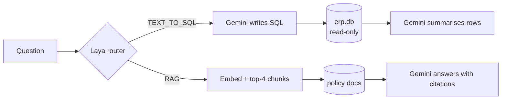

# ERP Assistant: Laya router + Text-to-SQL / RAG

A hybrid chatbot for ERP questions. A small fine-tuned [Laya](https://huggingface.co/convaiinnovations/laya) model decides how each question should be answered:

- **TEXT_TO_SQL**: questions about the company's own records ("How many invoices are overdue?"). Gemini writes a read-only SQLite query, it runs against the ERP database, and Gemini summarises the rows.
- **RAG**: policy, definition and how-to questions ("What is the process for onboarding a new vendor?"). The relevant company documents are retrieved and Gemini answers from them, citing the documents.

The hard part is telling apart questions on the *same topic* with *different intent*:

| Question | Route |
|---|---|
| What is my material receipt amount? | TEXT_TO_SQL |
| What is a material receipt? | RAG |



## Router results

Accuracy of `checkpoints/laya-erp-router` (full fine-tune, 4 epochs on a Colab T4) against the base model:

| Eval set | Base `convaiinnovations/laya` | Fine-tuned |
|---|---|---|
| `test.jsonl`: held-out templates, doctypes and terms (600) | 62.5% | **98.3%** |
| `handwritten_eval.jsonl`: realistic non-templated questions (100) | 64% | **94%** |

Inference takes about 0.6 s per question on CPU. Validation accuracy (100%) is not reported because the val set is a random slice of the training templates.

## Quick start

Requires Python 3.10+ and a [Gemini API key](https://aistudio.google.com/apikey).

```bash
pip install -r requirements.txt
cp .env.example .env            # then put your GEMINI_API_KEY in .env

python -m erp_assistant.web_app     # browser UI at http://127.0.0.1:8000
python -m erp_assistant.chatbot     # or the terminal chat; /sql <q> or /rag <q> forces a branch
```

Run every command from the repo root. On first use the RAG index is built from `data/erp/docs/` and cached in `data/erp/rag_index.npz`, which rebuilds automatically when the docs change.

> **About the router checkpoint:** the fine-tuned model (~1.5 GB) is not in this repo. The app looks for `checkpoints/laya-erp-router/`, then `checkpoints/laya-erp-router-head/`, and otherwise falls back to the base model from Hugging Face, which routes far less accurately (see the table above). Train your own checkpoint with the steps below.

### Web UI

Each answer shows the route and the router's confidence. SQL answers also have a collapsible section with the generated query and the result table. The page talks to one JSON endpoint:

```bash
curl -X POST http://127.0.0.1:8000/api/ask -H "Content-Type: application/json" \
     -d '{"question": "Which 5 customers have the highest total sales?"}'
# -> {"route": "TEXT_TO_SQL", "confidence": 0.9999, "answer": "...", "sql": "SELECT ...", "columns": [...], "rows": [...]}
```

RAG responses contain `sources` (document names) instead of `sql`/`columns`/`rows`. Use `--host` and `--port` to change where the server listens.

## Project layout

```
erp_assistant/
  chatbot.py            router + SQL branch + RAG branch; terminal chat
  web_app.py            stdlib HTTP server for the web UI and /api/ask
  static/index.html     single-page chat UI
  router_question.py    the routing question Laya is trained on (shared by every script)
  build_dataset.py      builds the Laya training data -> data/router/
  eval_router.py        scores checkpoints on test + handwritten sets
  generate_erp_data.py  builds the synthetic ERP database and docs -> data/erp/
  make_colab_zip.py     bundles code + data for Colab training
  config.py             repo paths and the .env loader
data/
  erp/                  erp.db (SQLite), schema.sql, docs/*.md (RAG corpus)
  router/               train/val/test.jsonl, handwritten_eval.jsonl
notebooks/
  train_laya_colab.ipynb   full fine-tune on a free Colab GPU
checkpoints/            trained routers (git-ignored)
```

## How it works

### SQL branch
Gemini receives `data/erp/schema.sql` and returns one query as JSON. Only a single `SELECT`/`WITH` statement is accepted. The database is opened read-only, at most 50 rows are fetched, and a SQLite error gets one automatic repair attempt. The data is synthetic, and "today" is fixed at **2026-10-11** so overdue and open statuses stay reproducible.

### RAG branch
Each document is split into its title plus groups of 3 lines and embedded with `gemini-embedding-001`. The 4 chunks most similar to the question (by cosine similarity) go to Gemini, which must answer only from them and cite the document names.

### Router training data
`build_dataset.py` crosses ERPNext doctypes (Sales Invoice, Material Receipt, BOM, …) and business terms with question templates. Every concept is asked both ways, as a records question and as a definition question, so the model learns intent rather than topic. Some templates, doctypes and terms are **held out entirely** for `test.jsonl`, so that set measures generalisation. `handwritten_eval.jsonl` is written by hand and never used for training.

## Training the router

The routing question lives in `router_question.py`. Change it and you have to regenerate the data and retrain.

```bash
# 1. (optional) regenerate the training data; it is deterministic for a given --seed
python -m erp_assistant.build_dataset --seed 42

# 2a. full fine-tune on a free GPU (recommended)
python -m erp_assistant.make_colab_zip        # -> colab_upload.zip
#     open notebooks/train_laya_colab.ipynb in Colab (T4 GPU), Run all, upload the zip,
#     then unzip the downloaded laya-erp-router.zip into checkpoints/laya-erp-router/

# 2b. or a fast head-only run on CPU
python -m laya.train_cli --data data/router/train.jsonl --eval data/router/val.jsonl \
    --base convaiinnovations/laya --out checkpoints/laya-erp-router-head \
    --freeze-encoder --shuffle-options --loss soft-ce --device cpu

# 3. compare checkpoints
python -m erp_assistant.eval_router --models convaiinnovations/laya checkpoints/laya-erp-router
python -m erp_assistant.eval_router --models checkpoints/laya-erp-router \
    --data data/router/handwritten_eval.jsonl --show-errors 30
```

Rebuild `colab_upload.zip` whenever you change the data, `router_question.py` or `eval_router.py`.

## Regenerating the ERP data

```bash
python -m erp_assistant.generate_erp_data --seed 42    # deletes and rebuilds data/erp/erp.db
```

The database has departments, employees and leave, customers and vendors, products and inventory, sales and purchase orders, invoices and payments: about 14k rows, all generated from one seeded RNG. The policy documents are defined inside the script.

## Configuration

| Variable | Default | |
|---|---|---|
| `GEMINI_API_KEY` (or `GOOGLE_API_KEY`) | — | required; read from the environment or `.env` |
| `GEMINI_MODEL` | `gemini-3.8-flash` | chat model for SQL generation and answers |

## Known limitations

- The ERP data and documents are synthetic. There's no per-user data, so "my" and "our" mean the whole company.
- The router still misses some phrasings: questions that start with "How many…" but ask about a policy (e.g. "How many leave days can I carry forward?") tend to go to SQL.
- The web server is meant for local use. It has no authentication and answers one question at a time.
